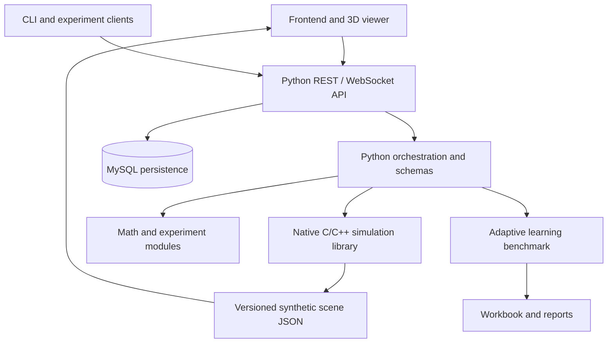

# System Architecture

## Purpose

The Synthetic Human Brain Program is a modular research and education platform for deterministic synthetic neural simulation, 3D scene inspection, mathematics experiments, and adaptive learning benchmarks. It is not a complete digital model of a human brain, and synthetic output must not be presented as empirical biological measurement.

## Logical components

## Component responsibilities

| Component | Responsibility | Boundary |
|---|---|---|
| Frontend | Visualize a scene, display experiment status, submit user actions | Never connects directly to MySQL |
| API | Input validation, request orchestration, REST and WebSocket boundary | Must authenticate and authorize production traffic |
| Native engine | Deterministic simplified neural-state simulation and C ABI | Synthetic model, not a biological digital twin |
| Scene exporter | Emit documented JSON fields for viewer consumption | Must preserve status and provenance metadata |
| Learning benchmark | Synthetic question bank, mastery and retention measures | Not a validated clinical IQ test |
| MySQL | Persist application and experiment records | Keep credentials out of source control |

## Data flow

1. A client submits a validated experiment request.
2. The API validates parameters and records an experiment identity.
3. The selected simulation or learning module executes a bounded job.
4. Status and outputs are returned through REST or WebSocket events.
5. Persisted records include model/version identifiers, configuration, timestamp, and provenance.
6. The viewer reads exported scene data and clearly labels synthetic output.

## Reliability and reproducibility

- Use deterministic seeds when a simulation component supports them.
- Persist parameter sets, software version, and input-data provenance with every result.
- Treat generated reports and scene exports as derived artefacts; retain source metadata.
- Reject malformed JSON at ingestion boundaries and test required output invariants.
- Place time and memory limits on user-submitted workloads.
- Do not run arbitrary user code inside the API process.

## Production security checklist

Production deployments should add authentication, authorization, TLS, restrictive CORS, request-size limits, rate limiting, audit logging, database migrations, secret management, backups, and dependency scanning. Local-development Docker settings are not production-ready by default.
