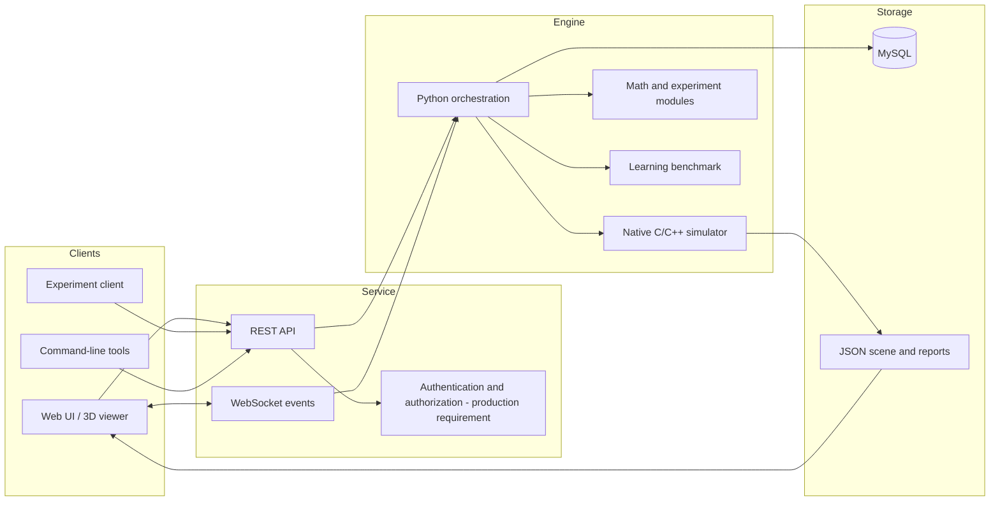

# UML — Component Diagram

The Mermaid graph below is a readable component view. It is intentionally implementation-oriented and does not imply clinical or biological equivalence.

## Key interfaces

- REST: validated request/response payloads; version endpoints when compatibility changes.
- WebSocket: typed event names, experiment ID, sequence/timestamp, and an explicit terminal state.
- C ABI: stable data types, explicit ownership/lifetime rules, and error/status codes.
- Scene JSON: a schema version, synthetic status label, neuron and connection arrays, and required per-record fields.
- Persistence: repositories/services own SQL access; clients never access the database directly.
