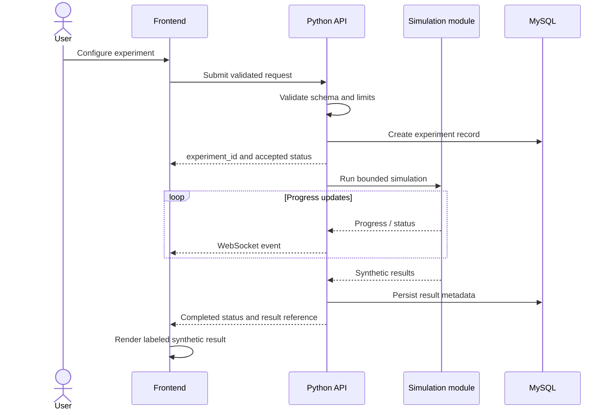

# UML — Experiment Sequence

## Failure paths

- Invalid input: return a stable client error and do not start work.
- Work limit exceeded: terminate the job safely and record a bounded failure status.
- Simulation error: record a sanitized failure reason and mark the experiment failed.
- Persistence error: do not report durable completion; surface a retryable error if appropriate.
- Client disconnect: simulation state should remain server-owned if the job is designed to continue.
